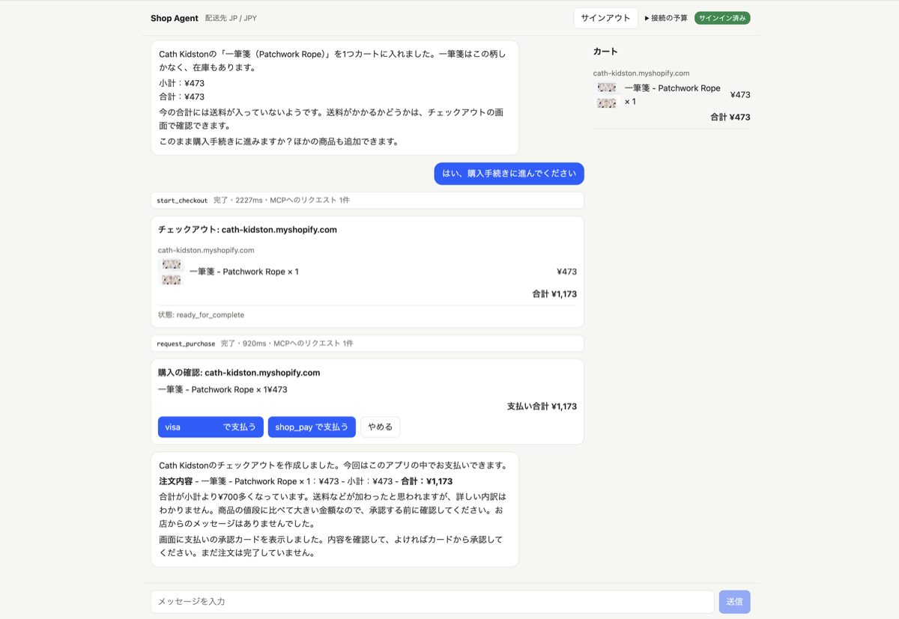

# shop-agent

Shopifyの[Shop MCP](https://mcp.shop.com)とClaude APIで作った、会話で買い物をするチャットエージェントです。ブラウザのGUIから、商品検索、カート追加、チェックアウトまで会話で進められます。

作った経緯とつまずいた点は、[Zennの記事](https://zenn.dev/takkuhiro/articles/shop-pay-agent)にまとめています。



## できること

- 検索は日本（JP/JPY）に固定しています。配送先が日本の商品だけが返り、価格は円で出ます。エージェントにもその前提を伝えています。
- 価格、評価、レビュー数、状態、出荷元、販売店、色やサイズ、類似商品、ページ送りを検索オプションとして使えます。
- 商品カードの「カートに入れる」から、またはチャットでカートを操作できます。
- チェックアウトはサインインなしでも作れます。その場合は店舗のページで支払います。Shopにサインインすると、アプリ内で支払えます。
- 支払いはモデルには任せません。モデルが出すのは承認カードだけで、購入者がボタンを押したときにサーバーが1回だけ支払いを実行します。

## 使い方

```bash
pnpm install
cp .env.example .env   # ANTHROPIC_API_KEY を設定
pnpm dev               # API は :8787、画面は http://localhost:5173
pnpm start             # 画面をビルドして :8787 だけで配信
pnpm test && pnpm typecheck && pnpm lint
```

アプリ内で支払うには、Shopのサインイン用クライアントIDを `.env` に設定します。`docs/shop-sign-in.md` を見てください。設定がなくても、検索、カート、店舗ページでの支払いは使えます。

## 構成

フロントとバックエンドは分けています。APIキーとShopのトークンをブラウザに置かないためです。

```
packages/contract   画面とサーバーの契約（zodのスキーマと型）
packages/server     Hono。ドメイン、アプリケーション、インフラ、プレゼンテーションの4層
packages/web        Vite + React。ストリーミング表示、商品カード、カート、承認、サインイン
```

サーバーはコンストラクタ注入で組み立てています。依存はドメインが持つポート（CatalogGateway、CartGateway、CheckoutGateway、AccountGateway、Authenticator）と、アプリケーション層のChatModelです。具体クラスを知るのは `src/composition.ts` だけで、テストでは偽物に差し替えています。

## 実装して分かったこと

- サーバーは2026-07-28版のステートレスなプロトコルのみに対応しています。initializeは不要で、各リクエストに `Mcp-Method` と `Mcp-Name` のヘッダーと `_meta` が要ります。そのため公式SDKは使わず、fetchで書きました。
- 検索結果は1回で約100KBありました。カートにも全決済方法の設定が入ります。モデルには必要な項目だけを渡しています。
- 金額は通貨の最小単位で返ります。USDの4200は42.00ドル、JPYの5700は5,700円です。換算はコード側で行い、モデルには整形済みの文字列を渡しています。
- 検索とカートで国を指定しないと、通貨が一致しないことがありました。同じ商品が検索ではUSD、カートではJPYで返りました。両方に同じ `context` を渡しています。
- `availability` が true でも、カート作成時に売り切れと分かる場合がありました。
- `update_cart` は差分ではなく文書全体の置き換えです。取得、1行の変更、レスポンス専用の `next` の削除、送信をコード側で行い、モデルにはカートIDを見せていません。
- 未ログインでもチェックアウトは作れますが、状態は `requires_escalation` になり、購入者が `continue_url` で続きを行います。
- 未サインインで `get_account` などを呼ぶとHTTP 401が返り、`WWW-Authenticate` に `scope="personal_agent"` が付きます。認可サーバーはaccounts.shop.appで、device codeフローに対応していました。
- 検索の価格フィルターはUSDを経由して換算されるようで、500円以下を指定して539円の商品が返ることがありました。本文にその旨のメッセージも付きます。そのためプロンプトで、価格は自分で確認するよう伝えています。
- 配送先の国は `context` の `address_country` で渡すと、検索の `ships_to` にも反映されました。
- 書き込み系のツール（`create_*` と `update_*`）は `meta["idempotency-key"]` にUUIDを付けられます。タイムアウトなどで結果が分からないときは、同じキーで再送すれば二重に作られません。このアプリでは、読み取りと、この4つの書き込みだけを最大3回まで再試行します。`complete_checkout` は再送せず、結果が不確かなときは `get_checkout` で確認します。
- 画面の各tool callは、クリックするとモデルからの入力、Shop MCPへ送ったHTTPリクエストとレスポンス、モデルに返した内容を見られます。このアプリはCLIを使わず、`https://mcp.shop.com` にJSON-RPCを直接送っています。Bearerトークンと支払いの `credential` は、画面に出る前に伏せています。
- セッションはサーバーのメモリにだけあります。タブごとのセッションIDをブラウザの `sessionStorage` に保存しているので、リロードしてもカートとサインインは引き継がれます。会話の表示はサーバーが持つイベント履歴から復元します。ツール呼び出しの詳細も戻り、承認カードは現在の状態で表示します。リロード時に実行中だったツール呼び出しは「実行中」のまま残ります。2時間使われなかったセッションは破棄しますが、Shopのサインインはトークンファイルに残ります。サーバーを再起動すると、会話とカートは新しいセッションになります。
- サインイン済みのときはヘッダーの「接続の予算」で、`get_account` が返す Shop Pay の予算と接続の管理リンクを読めます。住所とメールは返さず、会話のモデルにも渡しません。`requires_buyer_review` で止まる原因の切り分けに使います。
- Shopは、サインインのたびに新しい接続を作り、Shop Payの予算も接続ごとに持ちます。そこでサインインをファイル（`.data/shop-token.json`、権限600、gitignore済み）に保存し、再起動後も同じ接続を使います。予算の設定は一度で済みます。リフレッシュトークンは更新のたびに新しいものに変わるので、そのたびに書き直します。ファイルは暗号化していないので、パスワードと同じように扱います。場所は `SHOP_TOKEN_FILE` で変えられます。
- 画面のサインアウトは、保存したトークンを消すだけです。Shopの公式CLIの `logout` と同じで、接続はShopのアカウントに残ります。次のサインインは新しい接続になるので、不要になった接続は shop.app/account/connections から消します。調べた限りでは、`/oauth/revoke` はリフレッシュトークンを受け付けて200を返しましたが、接続は一覧から消えず、取り消し後もアクセストークンで `get_account` が通りました。そのため取り消しは使っていません。
- デバイスフローのリフレッシュトークンは、公式ドキュメントには書かれていませんが、実際には返ってきて使えました（`expires_in` は3600秒）。将来変わる可能性があります。
- 支払いが完了すると、そのお店のカートを空にし、チャットに「注文が完了しました」と表示します。この文面はモデルではなくアプリが決まった形で出します。注文の事実を言い間違えないためです。
- 支払い手段は、Shopが `delegated_budget`（このアプリに許可した予算）を返したときはそれだけを承認カードに出します。保存カード（visa）を指定した `complete_checkout` は、私が試した1店舗では `checkout_completion_ineligible` で拒否されたためです。予算がないときは返ってきたものをそのまま出します。

## ライセンス

MIT
